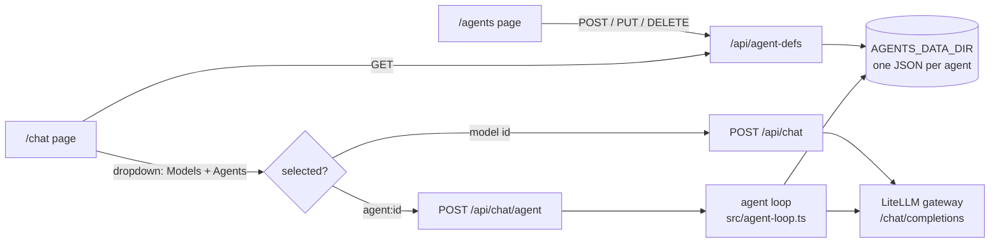
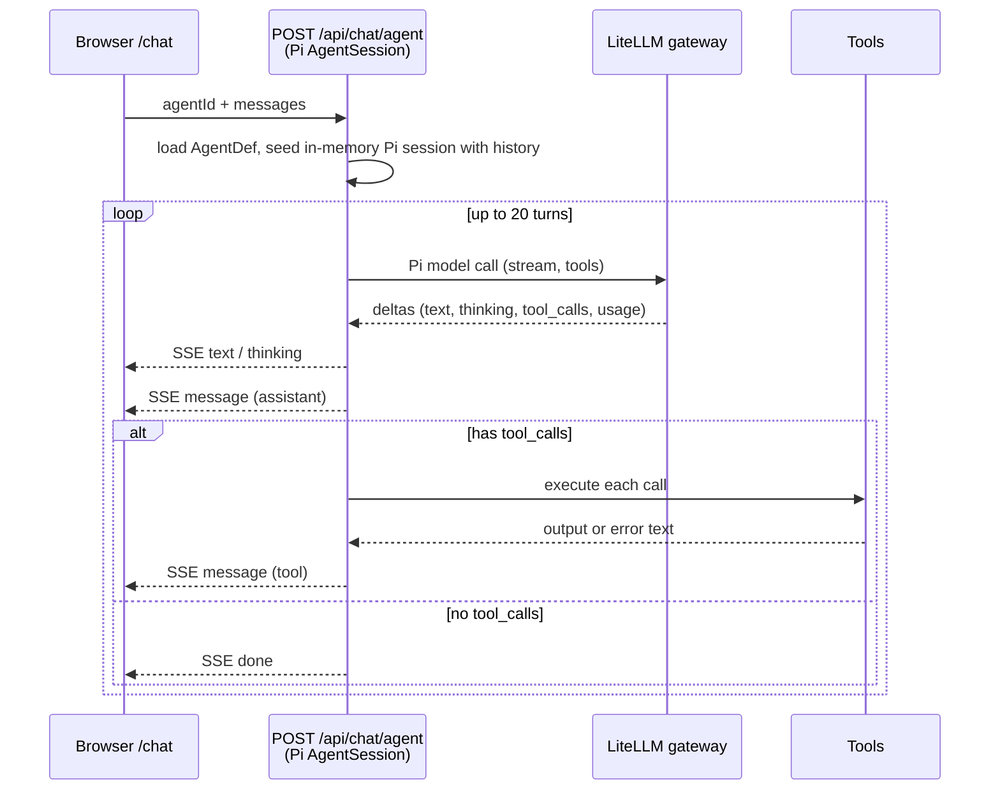

# 002 – Agent chat: agent loop in `/chat`

Status: **IMPLEMENTED (Pi SDK)**

## What was built
The `/chat` model dropdown is now grouped into two sections:

| Section | Backend | Behaviour |
|---|---|---|
| **Models** | `POST /api/chat` | Plain streaming chat completion, passthrough to the LiteLLM gateway. No system prompt, no tools. |
| **Agents** | `POST /api/chat/agent` | Server-side **agent loop**: agent's system prompt + tool calling + reasoning ("thinking") until the model finishes. |

Also in this change:
- Sidebar shows the model / `🍌 agent name` under each chat title.
- Header shows session info: context size (vs. model max), total in/out tokens, cache hit/miss, number of model calls.
- Chats are saved right after sending and after each agent turn, so they show in the sidebar immediately.

## How agents are created (spec 001)
Agents are managed on the `/agents` page (`src/client/agents/main.tsx`), API `/api/agent-defs` (`src/agent-defs.ts`).

```ts
type AgentDef = {
  id: string; name: string; description?: string;
  model: string;          // LiteLLM model id used for every turn
  systemPrompt: string;
  tools: string[];        // subset of the tool catalog below
  skills?: string[];      // names of skills (from /api/skills) the agent may use
  created: number; updated: number;
};
```
- One JSON file per agent in `AGENTS_DATA_DIR` (default `~/.local/share/banana-pi-agents`, `/data/agents` in Docker).
- `name` unique (case-insensitive); `tools` validated against the catalog (`GET /api/agent-tools`); `skills` is a list of skill names picked in the `/agents` form (checkboxes fed by `GET /api/skills`). Unknown/deleted skill names are ignored at run time.
- The chat page lists them via `GET /api/agent-defs`; the dropdown value for an agent is `agent:<id>`.



## Agent loop (`src/agent-loop.ts`)
Built on the **Pi SDK** (`@earendil-works/pi-coding-agent`). The browser is stateless: it sends the full OpenAI-format history (`{ agentId, messages }`) each request; the server runs one Pi session and streams events back as SSE. The last message must be a `user` message (else 400).

1. Load the `AgentDef`; register the LiteLLM gateway as an `openai-completions` provider on a `ModelRuntime` (`registerProvider`, model = `def.model`). Gateway metadata isn't available, so context window (200k), max output (16k) and cost (0) are placeholders.
2. Create an in-memory `SessionManager` and seed it with the history (all but the last message), converted OpenAI → Pi (`user`, `assistant` with `thinking`/`toolCall` blocks, `tool` → `toolResult`; `error` messages dropped).
3. `createAgentSession()` with: `systemPrompt` from the `AgentDef` via a minimal `ResourceLoader` (no extension/context-file discovery; only the selected skills), `cwd = AGENT_WORKDIR`, `skills` = the agent's selected skills (resolved by name from `SKILLS_DIRS`, loaded with the SDK's `loadSkillsFromDir`; Pi lists name/description/path in the system prompt and the model opens `SKILL.md` with `read`), `tools` = the agent's enabled tools, `customTools` = `web_fetch` / `web_search`, in-memory settings with compaction disabled, thinking level `off`.
4. `session.prompt(lastUserText)` runs Pi's agent loop (model call → tool execution → repeat until no tool calls). Tool errors are returned to the model as results, not thrown.
5. `session.subscribe()` events are translated to SSE: `message_update` (`text_delta` / `thinking_delta`) → `text` / `thinking`; `message_end` → `message` (assistant converted Pi → OpenAI with `tool_calls`, `thinking`, `usage`; `toolResult` → `tool` message).
6. Safety limit: **20 turns** (counted on `turn_end`, then `session.abort()`). Client disconnect calls `session.abort()`; the session is always `dispose()`d.



### SSE events
| type | payload |
|---|---|
| `text` / `thinking` | `{ delta }` – streaming chunk of the current assistant turn |
| `message` | `{ message }` – completed `assistant` (may include `tool_calls`, `thinking`, `usage`) or `tool` message |
| `error` | `{ error }` |
| `done` | end of stream |

### Tools
| id | Action | Notes |
|---|---|---|
| `read` / `write` / `edit` | file ops | Pi built-ins (`edit` uses exact text replacement) |
| `bash` | shell command | Pi built-in; no fixed 60 s timeout any more |
| `grep` / `find` / `ls` | search / list | Pi built-ins |
| `web_fetch` | HTTP GET | custom tool (`defineTool`) |
| `web_search` | Exa search | custom tool; needs `EXA_API_KEY` |

Built-ins come from the Pi SDK; only `web_fetch` / `web_search` are implemented here. Paths resolve against `AGENT_WORKDIR` (default: server cwd). Output truncation follows Pi's built-in limits (no longer the old 20 000-char cut).
⚠ **No sandboxing** – tools run with the server process's permissions.

## Client behaviour (`src/client/chat/App.tsx`)
- Agent turns are appended live: thinking in a collapsible block, tool calls and tool results as collapsible `🔧` blocks.
- The saved chat contains the full message list (assistant + tool messages), so a reopened chat resumes with correct context. Saved `model` is `agent:<id>`; a deleted agent shows as "deleted agent".
- Sessions: `/api/chat/sessions` (`CHAT_DATA_DIR`), unchanged apart from the extra message fields.

## Session info (header)
Usage comes from Pi's `Usage` on each assistant message, mapped to OpenAI-style fields (`prompt_tokens` = input + cacheRead + cacheWrite, `completion_tokens` = output, `prompt_tokens_details.cached_tokens` = cacheRead) and stored on the message.
- **ctx** = last call's `prompt_tokens` (vs. `max_input_tokens` from `/api/models`)
- **in / out** = sums of prompt / completion tokens over all calls
- **cache** = `prompt_tokens_details.cached_tokens` (or `cache_read_input_tokens`) / prompt tokens; miss = remainder
- Only replies made after this feature carry usage; requires the gateway to return usage when streaming. Plain `/api/chat` models are unchanged (raw gateway usage).

## Skills
The standalone `/skills` page was removed; skills are listed at the bottom of `/agents` (click a card for a details modal with description, source and `SKILL.md` body).
Per-agent, opt-in. A skill is not executed directly: Pi puts its name, description and path into the system prompt, and the model reads `SKILL.md` via the `read` tool, then follows it (possibly running bundled scripts via `bash`). So an agent needs `read` (and `bash` for script-based skills); the form warns if `read` is missing. Skills run unsandboxed like any tool.

## Known limitations / future
- No sandbox, permission prompts or per-agent working directory.
- Tool output is not streamed to the browser (Pi supports it; not wired up).
- Model metadata (context window, cost) is placeholder; Pi-side cost/compaction are unused.
- Thinking level is fixed to `off`; reasoning shown only if the gateway emits it.
- Prior assistant turns are replayed without provider thinking signatures or per-turn usage.
- Pi compaction is disabled – long agent chats will grow until the model limit.
- Agent edits only affect new messages; old chats use the agent's current definition.
- Stopping a run = closing the stream; no explicit "stop" button yet.

## Files
`src/agent-loop.ts` (Pi SDK), `src/agent-defs.ts`, `src/skills.ts`, `src/client/agents/main.tsx`, `src/chat.ts`, `src/server.ts`, `src/docs.ts`, `src/client/chat/App.tsx`, `src/client/chat/chat.css`
