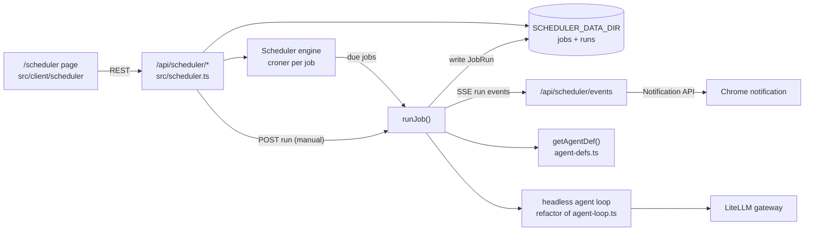
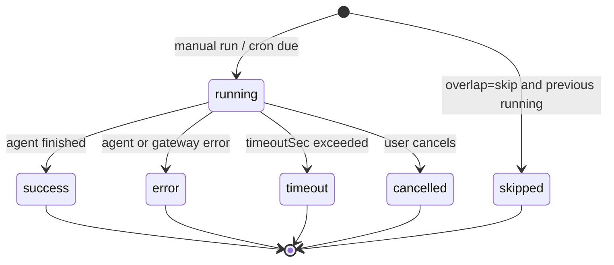
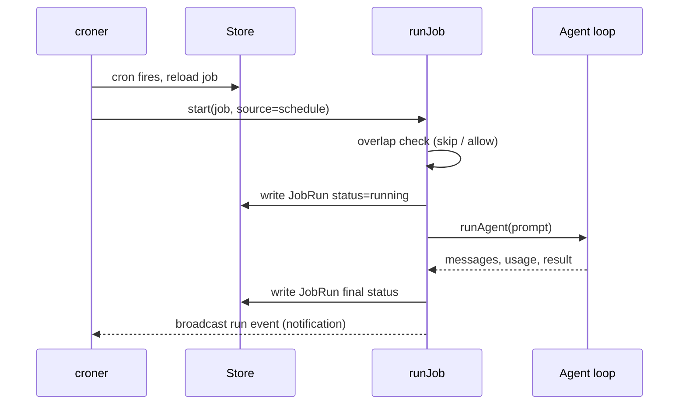
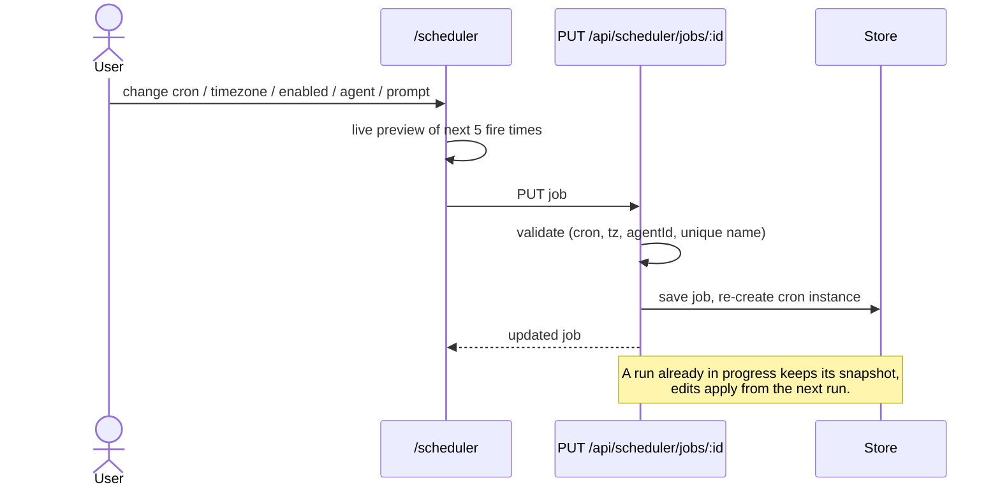
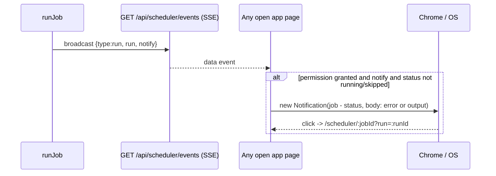
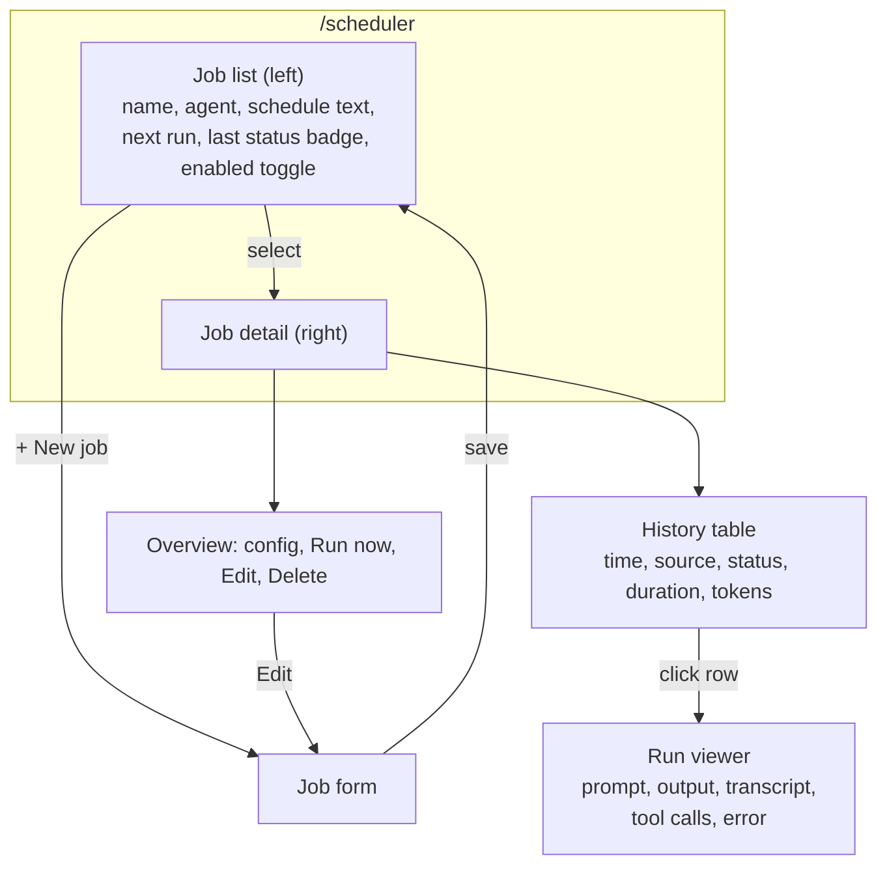

# 003 – Agent scheduler: `/scheduler` page

Status: **IMPLEMENTED**

Decisions: cron via the [`croner`](https://github.com/Hexagon/croner) library; Chrome desktop notifications when a run finishes; run history is shown **only** on `/scheduler` (not in `/sessions`).

## Goal
A new page `/scheduler` to manage **scheduled agent jobs**. Each job binds an existing agent (spec 001) to a fixed prompt and a trigger: **manual** only, or **scheduled** (cron / interval). Jobs can be run on demand, their schedule can be edited at any time, and the **history of every previous run** (status, duration, output, transcript) is browsable.

Non-goals (v1): multi-user auth, distributed workers, retries/backoff, webhook/Slack notifications, job chaining, "open in chat".

## Concepts
| Term | Meaning |
|---|---|
| **Job** (`ScheduledJob`) | A saved config: agent + prompt + trigger. Editable. |
| **Trigger** | `manual` (no automatic runs) or `cron` (5-field cron expr + IANA timezone, validated by `croner`). Intervals are cron (`*/15 * * * *`) via UI presets. |
| **Run** (`JobRun`) | One execution of a job (by `manual` or `schedule`). Immutable once finished. |

## Data model
```ts
type ScheduledJob = {
  id: string;
  name: string;                 // unique, case-insensitive
  description?: string;
  agentId: string;              // AgentDef.id (spec 001); validated on save and at run time
  prompt: string;               // sent as the single user message of each run
  trigger:
    | { type: 'manual' }
    | { type: 'cron'; expr: string; timezone: string };   // e.g. "0 9 * * 1-5", "Asia/Bangkok"
  enabled: boolean;             // false = schedule paused (manual run still allowed)
  overlap: 'skip' | 'allow';    // behaviour if previous run is still going (default 'skip')
  timeoutSec: number;           // default 600, hard cap per run
  notify: boolean;              // browser notification when a run finishes (default true)
  created: number; updated: number;
};

// API responses add derived fields: nextRunAt (from croner, not persisted), running (count), lastRun (summary).

type JobRun = {
  id: string;
  jobId: string;
  jobName: string;              // snapshot, survives rename/delete
  agentId: string; agentName: string; model: string;  // snapshots
  prompt: string;               // snapshot of prompt used
  source: 'manual' | 'schedule';
  status: 'running' | 'success' | 'error' | 'timeout' | 'cancelled' | 'skipped';
  scheduledFor?: number;        // planned time (schedule runs)
  startedAt: number; endedAt?: number;
  error?: string;
  output?: string;              // final assistant text
  messages: unknown[];          // OpenAI-format transcript (same as /chat), incl. tool calls
  usage?: { input: number; output: number; calls: number };
};
```

## Storage
Same pattern as `agent-defs.ts` (JSON files, env-configurable dir):
```
SCHEDULER_DATA_DIR (default ~/.local/share/banana-pi-scheduler, /data/scheduler in Docker)
├── jobs/<jobId>.json          # ScheduledJob
└── runs/<jobId>/<runId>.json  # JobRun (transcript included)
```
- Add `SCHEDULER_DATA_DIR: /data/scheduler` and a persistent volume to `docker-compose.yaml`.
- Run retention: keep last `SCHEDULER_MAX_RUNS` (default 200) runs per job; prune oldest after each run.
- On startup, any run left as `running` is marked `error: "server restarted"`.

## Architecture


### Engine (`src/scheduler.ts`)
- In-process, `startScheduler()` called from `src/index.ts`. One `croner` `Cron` instance per enabled cron job (`protect: true` prevents overlapping callbacks of the same instance); the map is rebuilt on create / update / delete / pause, so schedule edits apply immediately. `nextRunAt` = `cron.nextRun()`; `/api/scheduler/preview` uses `nextRuns(5)`.
- Expressions must have exactly 5 fields; timezone validated via `Intl.DateTimeFormat`.
- Missed runs while the server was down are **not** back-filled.
- In-memory map `jobId → AbortController` of active runs, used for overlap check and cancel.

### Headless run (`runJob`)
`agentChat` in `src/agent-loop.ts` is tied to an HTTP response (SSE). Refactor:
1. Extract the core into `runAgent({ def, messages, apiKey, signal, onEvent })` that emits the same events (`text`, `thinking`, `message`, `error`, `done`).
2. `agentChat` becomes a thin SSE wrapper around it (behaviour unchanged for `/chat`).
3. `runJob` calls `runAgent` with `messages = [{ role:'user', content: job.prompt }]`, collects `message` events into `JobRun.messages`, takes the last assistant text as `output`, and sums `usage`.
4. Gateway key: `apiKey()` from `src/chat.ts` (`LITELLM_API_KEY` or `LITELLM_KEY_FILE`); missing key → run `error`.
5. Timeout via a timer that aborts the run's `AbortController` → status `timeout`; cancel → `cancelled`. `POST .../run` returns immediately (202) while the run continues in the background.

### Run lifecycle


### Scheduled trigger flow


### Edit schedule flow


### Notifications (Chrome)

- A small script injected into every page by `withNav` in `server.ts` opens the SSE stream; no service worker, so notifications only appear while an app tab is open. `tag = runId` dedupes across tabs.
- Permission is requested from a user gesture: the **🔔 Enable notifications** button on `/scheduler`. States: default (button), granted ("notifications on"), denied (hint).
- Per-job `notify` toggle in the form. Skipped runs never notify.
- OS-level blocking (e.g. Windows Settings → Notifications for Chrome / Focus Assist) hides popups even when permission is granted.

## API (`src/scheduler.ts`, routed from `server.ts` like `agent-defs`)
| Method | Path | Purpose |
|---|---|---|
| GET | `/api/scheduler/jobs` | List jobs + `lastRun` summary (status, startedAt) + `nextRunAt` |
| POST | `/api/scheduler/jobs` | Create job |
| GET | `/api/scheduler/jobs/:id` | Get job |
| PUT | `/api/scheduler/jobs/:id` | Update (any field incl. trigger, enabled) |
| DELETE | `/api/scheduler/jobs/:id` | Delete job (runs history deleted too, after confirm) |
| POST | `/api/scheduler/jobs/:id/run` | Run now (manual); returns `{ runId }` immediately (202) |
| GET | `/api/scheduler/jobs/:id/runs?limit=&before=` | Run history summaries (no `messages`), newest first |
| GET | `/api/scheduler/runs/:runId` | Full run incl. transcript |
| POST | `/api/scheduler/runs/:runId/cancel` | Cancel a running run |
| DELETE | `/api/scheduler/runs/:runId` | Delete one history entry |
| POST | `/api/scheduler/preview` | `{ expr, timezone }` → `{ next: ms[] }` (5 fire times) or 400 |
| GET | `/api/scheduler/events` | SSE stream of `{ type:'run', run, notify }` on run start/finish (notifications + live UI refresh) |

Validation errors → 400 `{ error }`; unknown ids → 404 (same helpers as `agent-defs`).

## UI (`src/client/scheduler/`)
Files: `index.html`, `main.tsx`, `scheduler.css` (mirror `src/client/agents/`). `/scheduler` (+ `/scheduler/:jobId[?run=:runId]` SPA fallback) in `server.ts`, page registered in `src/client/build.ts`, "Scheduler" nav link. History is viewed only here; `/sessions` is untouched.



- **Job list**: status dot (green success / red error / blue running / grey never), human schedule ("Weekdays 09:00 Asia/Bangkok" or "Manual"), next run (relative), enable toggle.
- **Job form** (modal, create + edit, same component): name, description, agent select (`GET /api/agent-defs`), prompt textarea, trigger radio (Manual / Scheduled). Scheduled shows presets (every 15 min, hourly, daily at…, weekdays at…, custom cron), timezone select (default browser tz), live "next 5 runs" via `/preview`. Advanced: overlap policy, timeout. Warn if the agent was deleted.
- **Detail**: **Run now** button (disabled while running unless overlap=allow), **Cancel** when running; history refreshes on SSE events and polls every 3 s while any run is `running`. Rows have Cancel (running) / delete (finished); Pause/Resume for cron jobs.
- **Run viewer** (modal, deep-linkable via `?run=`): status, source, timings, token usage, model; collapsible prompt; output rendered as markdown; collapsible transcript (thinking, content, tool calls). Polls while running.
- Empty states: no jobs → CTA to create; no agents → link to `/agents`.

## Edge cases
- Agent deleted/edited: run fails with `error: "agent not found"`; edits to the agent apply on next run (snapshot stored on the run).
- Invalid cron / timezone rejected at save; job never gets a bad `nextRunAt`.
- Switching trigger to `manual` or `enabled=false` clears `nextRunAt`; scheduled runs stop immediately.
- Multiple server instances would double-fire (v1 assumes a single container).
- Clock changes/DST: handled by `croner` timezone support.
- Security: scheduled agents run with the agent's full tool set (incl. `bash`) unattended — surface this warning in the form when the agent has `bash`/`write`/`edit`.

## Implementation steps
1. `src/scheduler.ts`: types, storage, validation (`croner`), API handler. ✅
2. Refactor `agent-loop.ts` → `runAgent()` + SSE wrapper; verify `/chat` unchanged. ✅
3. Engine: per-job croner instances, `runJob`, overlap/timeout/cancel, startup recovery, retention; start from `index.ts`. ✅
4. Routing in `server.ts` + build entry in `client/build.ts`; docker-compose env/volume. ✅
5. Client page: list, form with cron preview, detail, history, run viewer. ✅
6. Update `src/docs.ts` with the new API endpoints (per repo rule) and `README.md`. ✅
7. Typecheck ✅ and manual test: manual run → history ✅, Chrome notification ✅. Still to verify by hand: scheduled firing (`* * * * *`), edit schedule → `nextRunAt` changes, cancel/timeout paths.

## Resolved / remaining questions
- Cron library vs. hand-rolled → **`croner`**.
- Notifications → **Chrome Notification API** via SSE (no push/service worker). Webhook/Slack remains future work.
- History in `/sessions` → **no**, `/scheduler` only.
- Future: background notifications via service worker/Web Push; back-fill missed runs.
